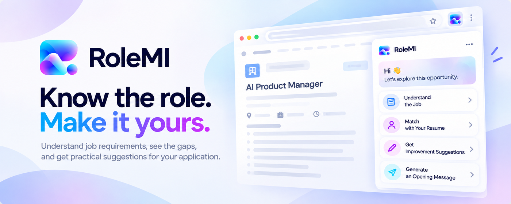

# RoleMI

<p align="center">
  
</p>

<p align="center">
  <strong>先看懂岗位，再决定怎么投。</strong>
</p>

RoleMI 是一款运行在浏览器侧边栏中的求职决策助手。

看到感兴趣的职位后，可以直接提取 JD，完成**岗位分析、简历匹配、修改建议和沟通准备**，并把职位保存到岗位池中继续管理。

```text
收集岗位 → 理解岗位 → 匹配简历 → 优化表达 → 准备沟通
```

## RoleMI 能做什么

**看懂岗位**  
提炼岗位本质、核心要求、隐含要求和理想候选人。

**看清差距**  
结合简历，将经历区分为**直接匹配、可迁移能力和关键缺口**。不把“相关”直接写成“具备”，也不使用缺少依据的匹配百分比。

**准备投递**  
基于岗位和真实经历生成简历修改建议与沟通开场白，帮助你更准确地表达自己。

**管理岗位**  
保存、搜索、收藏和管理感兴趣的职位，并支持 Excel 导出。每个岗位可以单独删除；手动添加的岗位还可以继续编辑。

## 为什么是 RoleMI

RoleMI 不是简单地把 ChatGPT 包装进浏览器插件。

它围绕一个岗位，把**提取、理解、匹配和投递准备**组织成连续流程；用相对稳定的分析框架判断岗位要求、能力证据和关键缺口，并保留与岗位相关的分析结果，减少反复复制 JD、切换对话和重新整理信息的成本。

## 当前支持

- **职位提取**：BOSS 直聘、智联招聘、猎聘
- **手动添加**：其他来源的职位描述，最多 2000 字；保存后可以继续编辑
- **简历格式**：PDF、DOCX
- **岗位管理**：搜索、收藏、状态管理、重复识别、Excel 导出
- **AI 能力**：岗位分析、简历匹配、修改建议、沟通开场白

RoleMI 暂不提供自动投递或招聘账号自动操作。最终是否投递，始终由你决定。

上传简历后会先完成简历理解，但不会自动开始匹配；匹配仍由你选择目标岗位后主动发起。手动岗位修改了标题、岗位描述等分析输入后，旧分析会提示重新分析。

## 数据与隐私

岗位、简历和分析结果主要保存在当前浏览器中。

只有在你主动使用 AI 功能时，完成对应任务所需的内容才会发送到当前选择的模型服务。匿名使用统计不保存岗位描述、简历正文或完整 AI 请求与响应。

### AI 使用额度

RoleMI 目前为个人维护项目，为控制 AI 服务成本并保证服务稳定性，项目提供的 AI 服务设置了以下使用限制：

* 单个安装实例每天最多 20 次 AI 请求
* 单个安装实例 60 秒内最多 6 次 AI 请求
* RoleMI 全体用户每天共享最多 200 次 AI 请求

每日额度按 UTC 时间重置。

岗位分析、简历匹配、修改建议、沟通开场白等 AI 功能均会计入 AI 请求次数。达到个人或全局额度后，需要等待对应额度恢复后才能继续使用 AI 功能。

这些限制主要用于项目早期上线阶段的成本控制和服务保护，后续会根据实际使用情况进行调整。

## 项目状态

当前版本：**v3.1.0**

RoleMI 上线 Microsoft Edge Add-ons。在Edge插件浏览器商城搜索🔍：**RoleMI**。

## 支持 RoleMI

RoleMI 是一个独立开发的个人项目。

如果你认可它的价值，也愿意支持它继续迭代，可以请我喝杯咖啡 ☕

<p align="center">
  
</p>

